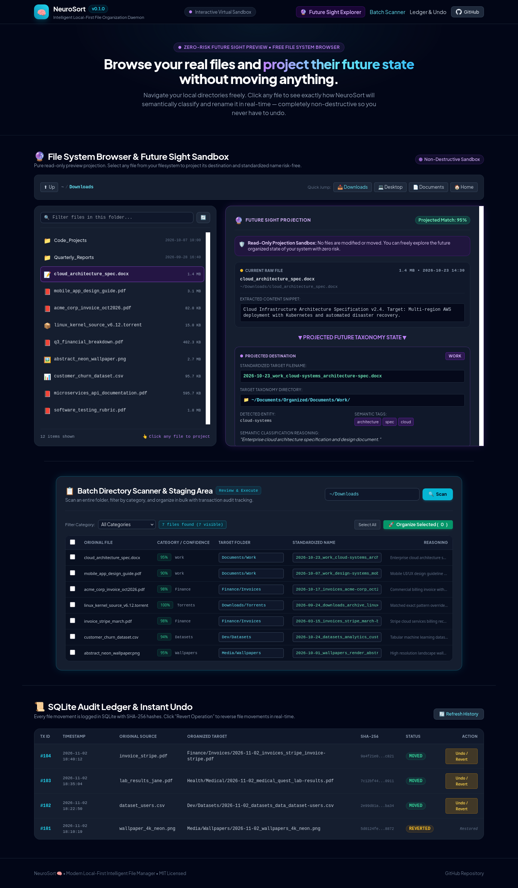
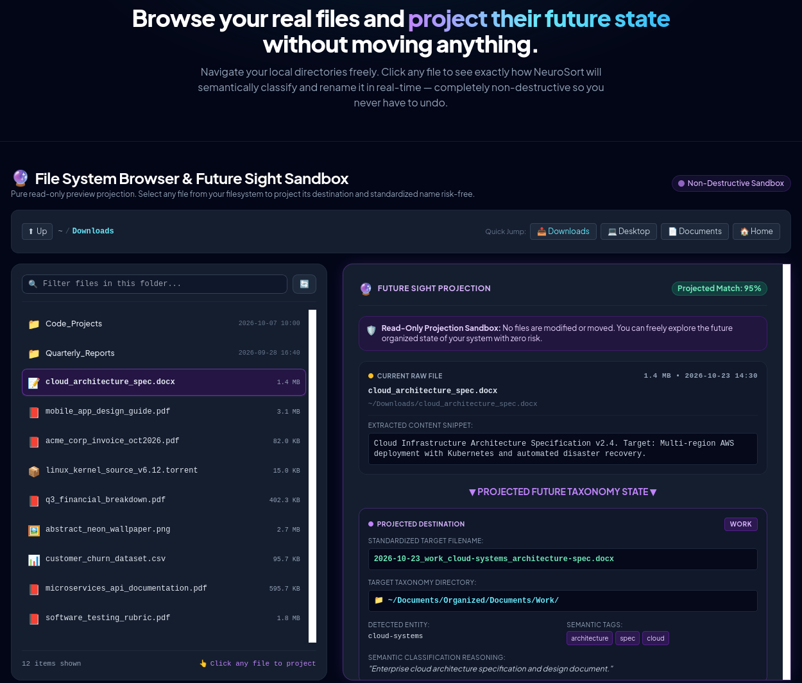
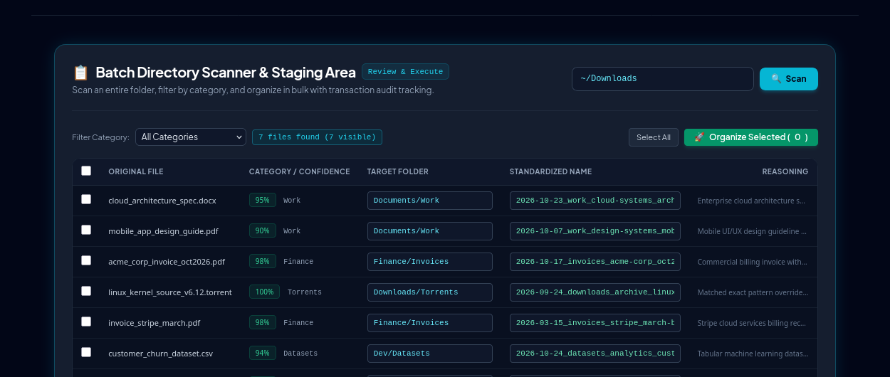
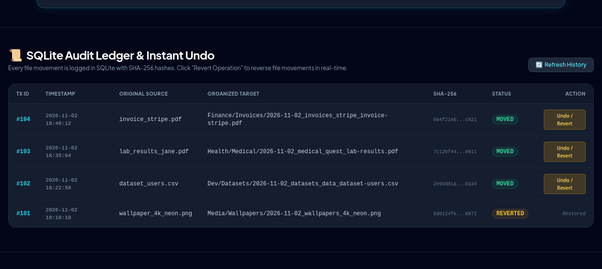

# NeuroSort 🧠📁

> **Modern, local-first, safe, and intelligent automatic file management daemon and CLI.**

[](https://www.python.org/)
[](https://opensource.org/licenses/MIT)
[](https://ollama.com)
[](https://sqlite.org)
[](#privacy--zero-data-loss-guarantee)

NeuroSort continuously monitors your intake directories (such as `~/Downloads` or `~/Desktop/Inbox`), extracts content metadata from documents, images, and source code, classifies files semantically using local LLMs or custom taxonomy rules, standardizes filenames with customizable naming templates, and organizes files into target directories with **zero data-loss risk** and **instant rollback** via an audit-grade SQLite transaction ledger.

---

## 📸 User Interface Overview

NeuroSort includes a built-in, local-first web interface that runs entirely on your machine (`http://127.0.0.1:8765`), allowing you to browse your local filesystem, preview future classifications without touching disk state, stage batch movements, and manage the transaction ledger with one-click undo.



---

## ⚡ Core Features & Capabilities

### 1. 🔮 Future Sight File System Explorer
Navigate through your real directories and select any file to inspect its extracted metadata and project its organized destination in real-time. Because it is completely read-only, you can inspect your entire system's organization with zero risk.



- **Real-Time Extraction Preview**: Inspect document text snippets, image EXIF/resolution data, or code package imports before any move takes place.
- **Projected Destination & Standardized Naming**: See the exact target directory, new sanitized filename, entity tags, and classification confidence score.
- **Selective Commit**: Move files individually directly from the projection view when you are satisfied with the result.

---

### 2. 📋 Batch Directory Scanner & Staging Area
Scan an entire intake directory (e.g. `~/Downloads`), view semantic classification recommendations, filter by category, and organize files in bulk.



- **Filter by Taxonomy**: View files by category (`Finance`, `Work`, `SourceCode`, `Datasets`, `Wallpapers`, `Torrents`, etc.).
- **Live Checkbox Selection**: Select all files or pick specific entries to organize.
- **Confidence Scoring**: High confidence matches (>80%) and heuristic matches are clearly distinguished.

---

### 3. 📜 SQLite Audit Ledger & Instant Rollback
Every file movement is atomically recorded in an ACID-compliant SQLite ledger operating in WAL (Write-Ahead Logging) mode.



- **Cryptographic Audit Trail**: Records transaction ID, ISO timestamp, source path, target path, file size, and streaming SHA-256 hash.
- **One-Click Revert**: Revert any transaction instantly from the GUI or CLI. NeuroSort restores the file to its original path and marks the transaction as `REVERTED`.
- **Bulk Rollback**: Undo multiple transactions or restore the entire directory history with `neurosort undo --all`.

---

## 🏛️ System Architecture

```
┌─────────────────────────┐
│ Watchdog Event Ingestor │ ───> Listens for on_created & on_moved filesystem events
└────────────┬────────────┘
             │
             ▼
┌─────────────────────────┐
│ 2-Stage Stabilization   │ ───> Dual-check (spaced 2s apart): checks non-zero size & zero delta
└────────────┬────────────┘      (Silently ignores .crdownload, .tmp, ~*, .*, .part)
             │
             ▼
┌─────────────────────────┐
│ Multi-Modal Extractors  │ ───> PyMuPDF (PDF), docx, CSV, Pillow/piexif (EXIF), Code AST, magic
└────────────┬────────────┘
             │
             ▼
┌─────────────────────────┐
│ 3-Tier Classifier       │ ───> 1. Exact Pattern Overrides (*.iso, *.torrent)
└────────────┬────────────┘      2. Ollama Local LLM (llama3.2 / phi3.5 structured JSON)
             │                   3. Taxonomy Keyword Cluster Heuristics (Offline fallback)
             ▼
┌─────────────────────────┐
│ Safe Atomic Executor    │ ───> Collision resolution (_v1, _v2), path traversal sanitization,
└────────────┬────────────┘      atomic shutil.move
             │
             ▼
┌─────────────────────────┐
│ SQLite WAL Ledger       │ ───> SHA-256 verification, transactions table, instant rollback
└─────────────────────────┘
```

---

## 🛠️ Technology Stack

| Layer | Component | Description |
| :--- | :--- | :--- |
| **Language** | Python 3.11+ | Modern type hints, dataclasses, asynchronous support |
| **CLI & TUI** | `typer` + `rich` | Progress bars, colored tables, interactive command prompt |
| **Filesystem Watcher**| `watchdog` | Debounced file system event streaming with custom stabilization |
| **Configuration** | `pydantic` v2 + `pyyaml` | Strict schema validation, automatic type coercion, safe YAML output |
| **Document Extraction**| `pymupdf` (fitz) | High-speed PDF text parsing with fallback to OCR for scanned sheets |
| **Image Extraction** | `Pillow` + `piexif` | EXIF metadata parsing (camera model, GPS coordinates, timestamps) |
| **Code Extraction** | Python AST & regex | Docstring parsing, imports, functions, and language categorization |
| **MIME Detection** | `python-magic` | Byte-signature inspection and MIME sniffing |
| **Local AI Layer** | `ollama` / `httpx` | Local zero-cloud inference (`llama3.2`, `phi3.5`) via JSON schema |
| **Audit Ledger** | `sqlite3` (WAL mode) | Transactional ledger, rollback tracking, streaming SHA-256 integrity |
| **Local Web GUI** | `ThreadingHTTPServer` | Lightweight embedded local web dashboard with REST API |

---

## 🚀 Installation

### 1. Prerequisites
- Python 3.11 or higher installed on your system.
- (Optional but recommended) [Ollama](https://ollama.com/) running locally for AI classification:
  ```bash
  ollama run llama3.2
  ```

### 2. Clone and Setup Environment

```bash
# Clone the repository
git clone https://github.com/ElXprogramming/neurosort.git
cd neurosort

# Create virtual environment
python3 -m venv .venv

# Activate virtual environment
# For Bash / Zsh:
source .venv/bin/activate

# For Fish shell:
source .venv/bin/activate.fish

# Install NeuroSort in editable mode with all dependencies
pip install -e .
```

---

## 💻 CLI Command Reference

### Initialize Configuration
Generate default `config.yaml` and create organized directory hierarchy:
```bash
neurosort init
```

### Dry-Run Scan (Preview without moving)
Preview how NeuroSort would organize a directory without modifying any files:
```bash
neurosort scan ~/Downloads --dry-run
```

### Execute Scan & Organize
Classify, standardize names, and move files immediately:
```bash
neurosort scan ~/Downloads
```

### Start Background Daemon (Interactive)
Run the debounced filesystem watcher daemon in the foreground:
```bash
neurosort start
```

### 🤖 24/7 Automated Background Service (Run on Boot / Login)
Install and enable NeuroSort as a permanent background service on Linux with `systemd`:
```bash
# Install and activate background service immediately
neurosort service install

# Check service status anytime
neurosort service status

# Stream live real-time ingestion logs
neurosort service logs -f

# Restart or stop the service
neurosort service restart
neurosort service stop

# Completely uninstall the service
neurosort service uninstall
```
> **Tip for Headless / SSH**: To keep the service running even when you are logged out or after a reboot without graphical login, run:
> ```bash
> loginctl enable-linger $USER
> ```


### Launch Interactive Web Interface
Start the local dashboard at `http://127.0.0.1:8765`:
```bash
neurosort ui
```
Options:
- `--port 8765`: Specify custom port.
- `--no-browser`: Do not automatically open the system browser.

### Inspect Transaction History
View recently executed file operations from the SQLite audit ledger:
```bash
neurosort history --limit 25
```

### Rollback & Undo File Movements
Undo the most recent file movement:
```bash
neurosort undo
```
Undo a specific transaction by ID:
```bash
neurosort undo --id 42
```
Undo the last N operations:
```bash
neurosort undo --last 5
```
Undo all recorded transactions:
```bash
neurosort undo --all
```

---

## ⚙️ Configuration Reference (`config.yaml`)

NeuroSort is configured through an annotated `config.yaml` located in the root of the project or `~/.neurosort/config.yaml`:

```yaml
# Monitored directories with debounce delays (seconds)
watch_paths:
  - path: "~/Downloads"
    debounce_seconds: 5.0
  - path: "~/Desktop/Inbox"
    debounce_seconds: 5.0

# Target root directory for sorted hierarchy
destination_root: "~/Documents/Organized"

# Rule precedence engine
rules_precedence:
  # Tier 1: Exact extension/pattern overrides (100% confidence, bypasses AI)
  exact_overrides:
    "*.iso": "Archives/ISO"
    "*.dmg": "Installers/macOS"
    "*.deb": "Installers/Linux"
    "*.rpm": "Installers/Linux"
    "*.torrent": "Downloads/Torrents"

  # Tier 2: Taxonomy clusters for semantic keyword matching
  taxonomy_clusters:
    "Finance/Invoices":
      - "invoice"
      - "receipt"
      - "billing"
      - "tax"
      - "statement"
    "Health/Medical":
      - "prescription"
      - "medical"
      - "lab_result"
      - "blood_test"
    "Dev/Datasets":
      - "dataset"
      - "csv"
      - "jsonl"
      - "parquet"
    "Dev/SourceCode":
      - "script"
      - "source"
      - "python"
      - "rust"
    "Media/Wallpapers":
      - "wallpaper"
      - "background"
      - "4k"
      - "desktop"
    "Documents/Work":
      - "report"
      - "contract"
      - "nda"
      - "proposal"

# Renaming template standard
# Tokens: {date}, {category}, {entity}, {original_title}, {ext}
renaming_template: "{date}_{category}_{entity}_{original_title}.{ext}"

# Intelligence provider configuration
ai_provider:
  provider: "ollama"           # Options: 'ollama' or 'openai'
  model: "llama3.2"           # Default local model
  temperature: 0.0             # Deterministic zero-temperature classification
  base_url: "http://localhost:11434"
  fallback_to_rules: true     # Fallback to keyword heuristics if Ollama is unreachable

# Safety and execution settings
dry_run: false
ignore_patterns:
  - "*.crdownload"
  - "*.tmp"
  - "~*"
  - ".*"
  - "*.part"
  - "*.swp"

# Audit ledger location
database_path: "~/.neurosort/ledger.db"
```

---

## 🔌 Local REST API Reference

When `neurosort ui` is running, a built-in REST API is exposed locally on `http://127.0.0.1:8765`:

| Method | Endpoint | Description |
| :--- | :--- | :--- |
| `GET` | `/api/status` | Returns system health, daemon running state, and watched paths |
| `GET` | `/api/fs/browse?path=...` | Safely browse local directories and file lists |
| `GET` | `/api/fs/preview?path=...` | Extract metadata and calculate future-sight projection for a file |
| `POST` | `/api/fs/commit` | Commit a single projected file move into organized destination |
| `POST` | `/api/scan` | Trigger a directory scan and return staged classifications |
| `POST` | `/api/organize` | Execute batch organization on selected files |
| `GET` | `/api/history?limit=30` | Query transaction records from the SQLite ledger |
| `POST` | `/api/rollback` | Revert a transaction by `{ "tx_id": 104 }` |
| `GET` | `/api/config` | Fetch active configuration as JSON |
| `POST` | `/api/config` | Update configuration settings dynamically |

---

## 🔒 Privacy & Zero Data-Loss Guarantee

1. **100% Local-First**: NeuroSort processes all files locally on your machine. Content text snippets, image EXIF, and metadata are sent **only to your local Ollama daemon** (`127.0.0.1:11434`). No file content or metadata is ever transmitted to external servers.
2. **Atomic Operations**: Files are moved using Python's atomic `shutil.move` operations within the filesystem boundary.
3. **Collision Protection**: If a file with the target standardized name already exists in the destination folder, NeuroSort automatically applies collision resolution (`_v1`, `_v2`, `_v3`) to ensure no existing file is overwritten.
4. **Path Traversal Shield**: All generated paths and standardized names are strictly sanitized to prevent directory traversal attacks (`../`, illegal characters, absolute path escapes).
5. **Streaming Integrity**: Source files are fingerprinted using streaming SHA-256 chunk hashing (64 KB buffers), enabling lightweight memory usage even for multi-gigabyte video or archive files.

---

## 🧪 Test Suite

NeuroSort includes a comprehensive test suite covering all core subsystems, extractors, ledger transactions, and watcher daemon debounce routines.

Run the test suite:
```bash
pytest -v
```

Output:
```
============================= test session starts ==============================
collected 33 items

tests/test_classifier.py::test_exact_override_precedence PASSED          [  3%]
tests/test_classifier.py::test_heuristic_invoice_classification PASSED   [  6%]
tests/test_classifier.py::test_heuristic_medical_classification PASSED   [  9%]
tests/test_classifier.py::test_sanitization_blocks_path_traversal PASSED [ 12%]
tests/test_cli.py::test_cli_init_command PASSED                          [ 15%]
tests/test_cli.py::test_cli_scan_dry_run PASSED                          [ 18%]
tests/test_cli.py::test_cli_scan_execute_and_history_and_undo PASSED     [ 21%]
tests/test_cli.py::test_cli_undo_all PASSED                              [ 24%]
tests/test_config.py::test_default_config PASSED                         [ 27%]
tests/test_config.py::test_save_and_load_config PASSED                   [ 30%]
tests/test_config.py::test_watch_paths_normalization PASSED              [ 33%]
tests/test_executor.py::test_atomic_move_success PASSED                  [ 36%]
tests/test_executor.py::test_collision_resolution PASSED                 [ 39%]
tests/test_executor.py::test_dry_run_leaves_disk_untouched PASSED        [ 42%]
tests/test_executor.py::test_rollback_restores_file PASSED               [ 45%]
tests/test_extractors.py::test_extract_text_document PASSED              [ 48%]
tests/test_extractors.py::test_extract_csv_document PASSED               [ 51%]
tests/test_extractors.py::test_extract_pdf_document PASSED               [ 54%]
tests/test_extractors.py::test_extract_image_with_exif PASSED            [ 57%]
tests/test_extractors.py::test_extract_source_code PASSED                [ 60%]
tests/test_hashing.py::test_calculate_sha256 PASSED                      [ 63%]
tests/test_hashing.py::test_sanitize_filename_removes_traversal_and_illegal_chars PASSED [ 66%]
tests/test_hashing.py::test_sanitize_filename_empty PASSED               [ 69%]
tests/test_hashing.py::test_sanitize_path_blocks_traversal PASSED        [ 72%]
tests/test_hashing.py::test_sanitize_path_empty_or_root PASSED           [ 75%]
tests/test_ledger.py::test_ledger_creation_and_indexes PASSED            [ 78%]
tests/test_ledger.py::test_ledger_record_and_query PASSED                [ 81%]
tests/test_ledger.py::test_ledger_history_and_reverted PASSED            [ 84%]
tests/test_server.py::test_server_state_lifecycle PASSED                 [ 87%]
tests/test_server.py::test_format_file_size PASSED                       [ 90%]
tests/test_watcher.py::test_stabilization_checker_stable_file PASSED     [ 93%]
tests/test_watcher.py::test_watcher_ignores_temporary_files PASSED       [ 96%]
tests/test_watcher.py::test_stabilization_checker_empty_file PASSED      [100%]

============================== 33 passed in 1.48s ==============================
```

---

## 📜 License

Distributed under the MIT License. See [LICENSE](LICENSE) for more information.

Developed by the NeuroSort Engineering Team.
